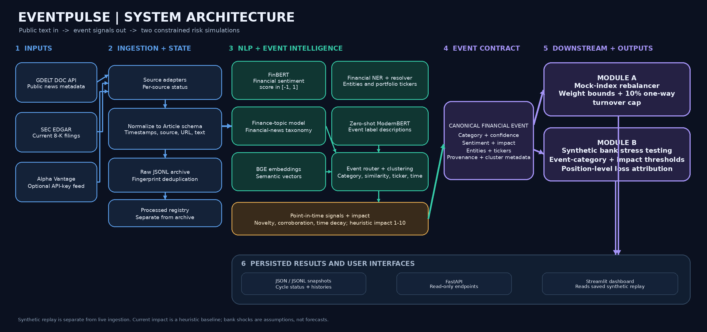

# EventPulse - S&P Global & Crisil Campus Hackathon 2026

> **From headlines to events to impact to action.**

**Candidate Name:** Vansh Goyal  
**College Email ID:** vansh23577@iiitd.ac.in 
**College / Campus:** IIIT Delhi  
**Demo Video Link (YouTube Unlisted):** _TODO: add after recording the 10-minute walkthrough_  
**Slide Deck:** [Presentation PDF](docs/presentation.pdf) | [Editable PowerPoint](docs/presentation.pptx)  
**Architecture:** [Mermaid source](architecture.md) | [Rendered diagram](docs/architecture.png)  
**Public Repository:** https://github.com/vanshg18/IIITD-Vansh-Goyal-hackathon

## 1. Project Overview / Problem Statement & Approach

Financial-risk teams need to triage a continuous stream of financial news and corporate disclosures. Raw headlines are unstructured, several outlets may report the same event, and linguistic sentiment alone does not explain which company is involved or whether an event should trigger a downstream risk workflow.

EventPulse ingests public news and SEC filings, normalizes them into a shared article schema, and applies pretrained NLP models for financial sentiment, entity extraction, financial-topic classification, zero-shot event classification, and semantic embeddings. A confidence-aware router and time-aware clustering logic turn these outputs into structured `FinancialEvent` signals with source provenance, tickers, sentiment, event type, novelty/corroboration metadata, and an interpretable 1-10 impact score.

The same event contract feeds two simulations: **Module A**, a constrained mock-index rebalancer, and **Module B**, a scenario-triggered stress tester for a synthetic banking portfolio. A Streamlit dashboard visualizes the reproducible synthetic end-to-end replay. This is a risk-intelligence prototype, not an automated trading system or validated market-loss predictor.

## 2. Architecture & Tech Stack



Full Mermaid source and detailed components: [`architecture.md`](architecture.md); standalone diagram source: [`docs/architecture.mmd`](docs/architecture.mmd).

### Technology stack

- **Python 3.11/3.12:** orchestration, data models and simulation logic.
- **Pydantic:** validated `Article`, `FinancialEvent`, and portfolio schemas.
- **Hugging Face Transformers / PyTorch:** pretrained NLP inference.
- **Sentence Transformers / scikit-learn:** embeddings, cosine similarity and clustering utilities.
- **Pandas / NumPy / SciPy:** data handling and numerical portfolio calculations.
- **FastAPI / Uvicorn:** optional read-only API over saved output files.
- **Streamlit / Plotly:** local dashboard and interactive charts.
- **JSON / JSONL:** article archive, event outputs, portfolio snapshots, and scenario history.

### Model inventory and purpose

| Model / component | Purpose | Status |
|---|---|---|
| `ProsusAI/finbert` | Financial sentiment; signed score in `[-1, 1]` | Pretrained inference |
| `whataboutyou-ai/financial_bert` | Financial named-entity extraction | Pretrained inference |
| `leonas5555/finnews-topic-single-classify` | Financial-news topic classification | Pretrained inference |
| `MoritzLaurer/ModernBERT-base-zeroshot-v2.0` | Scores candidate event-category descriptions | Pretrained inference; combined by router |
| `BAAI/bge-small-en-v1.5` | Text embeddings for semantic similarity | Pretrained general-purpose English embedding model |
| `src/engine/impact.py` | Explainable 1-10 impact estimate | Heuristic baseline currently active |

The event router uses model agreement, confidence thresholds, and the margin between the leading zero-shot labels as routing evidence. These are fixed design rules, not learned/calibrated probabilities. The active impact score is a severity/confidence heuristic. A historical impact-training workflow is present, but the reviewed repository does **not** contain an accepted `models/impact_model.joblib` artifact, so the live engine uses the heuristic baseline.

## 3. Dataset Used

The repository includes a small, fully synthetic dataset for repeatable demonstrations; it does not include proprietary S&P Global or Crisil data.

| File | Nature and role |
|---|---|
| `data/demo/articles.json` | 12 hand-authored fictional financial headlines/articles with synthetic timestamps and fictional companies/tickers. This is the input for the current end-to-end demo replay. |
| `data/demo/event_eval.json` | Expected event labels for the 12 synthetic article IDs. It is a small synthetic smoke-test fixture, not an independently labelled real-news benchmark. |
| `data/demo/portfolio.json` | Fictional company portfolio used by the synthetic Module A replay (for example, QDEV, NVBK, MCRD and CLMX). |
| `data/demo/banking_portfolio.json` | Synthetic banking portfolio with eight positions and a declared aggregate value of 1,000,000,000 portfolio units. The file currently does not declare a currency. |
| `data/demo/bank_stress_scenarios.json` | Synthetic event categories, impact thresholds and assumed shocks used by Module B. |
| `data/demo/index_portfolio.json` | Separate 12-stock real-ticker mock-index universe for the live pipeline. Equal weights are a simulation and are not official S&P Global 100 index weights. |
| `data/demo/stress_scenarios.json` | Additional/legacy synthetic scenario fixture used by the demo ingestion helper; the current `run_demo_pipeline` uses `bank_stress_scenarios.json` for Module B. |

**Live sources:** GDELT DOC public news metadata and SEC EDGAR current 8-K filings; an Alpha Vantage feed is optional and requires an API key. Source data are fetched at runtime, subject to provider connectivity and rate limits. GDELT may return a headline rather than the full article body.

**Historical data:** no real historical news or price dataset is bundled or claimed as training data. The repository includes scripts to score a public historical-news dataset and train/evaluate a historical impact model if you provide licensed data under `data/raw/`. The README's example FNSPID workflow is a suggested future experiment, not evidence that FNSPID was used in the results below. Verify the license and terms of any external dataset before use. Raw downloads and generated outputs are ignored by Git.

## 4. Quickstart & Installation

### Runtime

Python 3.11 or 3.12. The development run was performed on Windows in a Python virtual environment. A first run downloads pretrained model weights and needs network access; later runs can reuse the local model cache.

### Install on Windows Command Prompt (CMD)

```cmd
 git clone https://github.com/vanshg18/IIITD-Vansh-Goyal-hackathon.git
 cd IIITD-Vansh-Goyal-hackathon
 python -m venv .venv
 .venv\Scripts\activate
 python -m pip install --upgrade pip
 python -m pip install -r requirements.txt
```

PowerShell users can activate with `.venv\Scripts\Activate.ps1` instead.

### Run the reproducible synthetic end-to-end demo

Run the pipeline **before** starting Streamlit because generated outputs under `data/processed/` are intentionally ignored by Git.

```cmd
python -m src.engine.run_demo_pipeline
python -m streamlit run src/dashboard/app.py
```

The dashboard has three tabs: Risk Feed, Module A - Rebalancer, and Module B - Stress Test. It reads saved replay outputs and does not load transformer models for each dashboard refresh. All displayed results are labelled synthetic simulations.

### Run live ingestion and downstream processing

1. Copy `.env.example` to `.env`.
2. Replace the example `SEC_USER_AGENT` with a descriptive application name and your real contact email, e.g. `SEC_USER_AGENT=EventPulse/1.0 Your Name your.email@college.example`. Do not commit `.env` or share credentials.
3. `ALPHAVANTAGE_API_KEY` may remain empty; that feed is optional. GDELT needs no API key.
4. Run:

```cmd
python -m src.engine.run_live_pipeline --limit 10 --timespan 1day
```

The run writes outputs under `data/processed/`: `live_articles.jsonl`, `processed_articles.json`, `latest_events.jsonl`, `events_history.jsonl`, `latest_rebalance.json`, `rebalance_history.jsonl`, `index_portfolio_state.json`, `latest_stress_results.jsonl`, `stress_results_history.jsonl`, and `latest_cycle_status.json`.

A source can fail while another source continues. Inspect `latest_cycle_status.json` for each source's status. HTTP 429 means a provider is rate-limiting requests; avoid repeated rapid retries. Live mode does not silently switch to synthetic fixtures.

### Optional: read-only API

After a live or synthetic cycle has generated the expected files, start the API:

```cmd
python -m uvicorn src.api.main:app --reload
```

Open `http://127.0.0.1:8000/docs` for interactive API documentation. Routes include `/api/v1/health`, `/api/v1/cycle/latest`, `/api/v1/events/latest`, `/api/v1/events/history`, `/api/v1/module-a/latest`, `/api/v1/module-a/history`, `/api/v1/module-b/latest`, `/api/v1/module-b/history`, and `/api/v1/summary`.

### Tests

```cmd
python -m pytest -q
```

Observed local run: **81 passed, 1 warning**. The warning is a Starlette/HTTPX test-client deprecation warning. These tests check software behaviour; they are not real-world NLP accuracy metrics.

## 5. Key Results & Domain Impact

### Synthetic end-to-end replay

Observed from `python -m src.engine.run_demo_pipeline` and displayed in the Streamlit app:

| Measure | Observed result |
|---|---:|
| Synthetic articles loaded | 12 |
| Structured events emitted | 12 |
| Events used by Module A | 5 |
| Module A one-way turnover | 9.15% |
| Configured Module A turnover cap | 10% |
| Module B stress scenarios triggered | 2 |
| Software tests | 81 passed, 1 warning |

The two independently evaluated synthetic Module B scenarios were:

| Scenario | Trigger event / impact | Portfolio before | Portfolio after | Simulated loss |
|---|---|---:|---:|---:|
| Broad Credit Deterioration | Credit / 8.86 out of 10 | 1,000,000,000 | 929,056,000 | 70,944,000 (7.0944%) |
| Unexpected Monetary Tightening | Monetary Policy / 8.24 out of 10 | 1,000,000,000 | 944,540,000 | 55,460,000 (5.5460%) |

Amounts are generic portfolio units because the current synthetic bank fixture does not declare a currency. The two stress outcomes are separate hypothetical scenarios against the same starting portfolio, not cumulative losses and not forecasts of an actual bank.

### Live-source smoke test observed during development

A live run successfully fetched **10 SEC EDGAR records**. GDELT returned **HTTP 429** (rate limited) in that run. The engine generated 10 structured events, but Module A used zero events because the reported tickers did not match the separate 12-stock mock-index portfolio, and Module B triggered zero scenarios because those event categories/impact scores did not meet the configured rules. This demonstrates source status reporting and strict eligibility, not successful live downstream action for that particular batch.

### Domain impact

- Provides a common event schema so multiple downstream workflows can reuse NLP outputs.
- Preserves source provenance and timestamps to support review and traceability.
- Reduces duplicate influence by clustering related reports and limiting same-cluster contributions.
- Demonstrates constrained portfolio rebalancing and scenario-based loss attribution.
- Offers repeatable synthetic results for a reliable walkthrough when a live provider is rate-limited.

## Optional historical-impact model workflow (not used for the reported demo metrics)

The repository includes scripts for an optional historical impact experiment. This requires you to obtain an appropriately licensed public news dataset and historical prices; neither is bundled or claimed as having been used for the demo results above. Keep downloads under `data/raw/` locally (that directory is Git-ignored).

1. Score a deterministic sample of news with the same NLP models used in inference:

```cmd
python -m src.ml.score_historical_news --input data/raw/your_news.csv --tickers AAPL,MSFT,NVDA,AMZN,JPM --limit 2000 --sample-seed 42 --device -1
```

2. Build targets and train/evaluate against historical prices:

```cmd
python -m src.ml.train_market_impact --prices data/raw/your_prices.zip --benchmark-tickers AAPL,MSFT,NVDA,AMZN,JPM
```

Review `data/processed/impact_model_metrics.json`. The code accepts a model only when validation MAE beats a training-median baseline and the feature schema matches live inference. This workflow has **not** produced the accepted model artifact used for the current reported results; the heuristic remains active. Daily close data are only a proxy for event reaction timing, not causal attribution.

## Limitations and honest evaluation status

- FinBERT sentiment is not a stock-return prediction.
- The 1-10 impact score is a configurable heuristic, not a calibrated probability or expected loss.
- The small synthetic fixture set is for demonstrating code paths and smoke-testing; no independent real-headline accuracy/precision/recall/F1 or economic backtest result is claimed here.
- The historical impact model workflow requires external historical news and prices and a successful acceptance check; no accepted model artifact is included in the reviewed repository version.
- GDELT may be rate-limited, and metadata-only headlines can lack the context available in full article text.
- Module A uses simulated weights, not official index weights or actual trades.
- Module B uses a synthetic banking portfolio and manually configured scenario shocks. It is not a valuation of a real bank.
- The Streamlit dashboard is a **local synthetic demo**, not a deployed cloud service. Cloud deployment is not specified as a requirement in the provided submission guidelines. Because `data/processed/` is Git-ignored, a fresh cloud deployment would need tracked demo results or a documented generation step.

## Submission and links

- Slide deck: [`docs/presentation.pdf`](docs/presentation.pdf) (7 slides; within the 5-7-slide guideline).
- Editable deck: [`docs/presentation.pptx`](docs/presentation.pptx).
- Architecture: [`architecture.md`](architecture.md) and [`docs/architecture.png`](docs/architecture.png).
- 10-minute walkthrough script: [`docs/demo_walkthrough_script.md`](docs/demo_walkthrough_script.md).
- 5-minute live demo script: [`docs/live_demo_5min_script.md`](docs/live_demo_5min_script.md).
- **Demo video:** replace the placeholder at the top with the final 10-minute YouTube Unlisted link. Test that it plays in a private/incognito window before submitting.

## Data, licensing and responsible use

The repo includes an MIT license. Use only synthetic or publicly available data, follow provider terms/rate limits, and do not commit API keys, `.env`, private data, downloaded model checkpoints or large datasets. No proprietary or confidential S&P Global or Crisil data are included.
