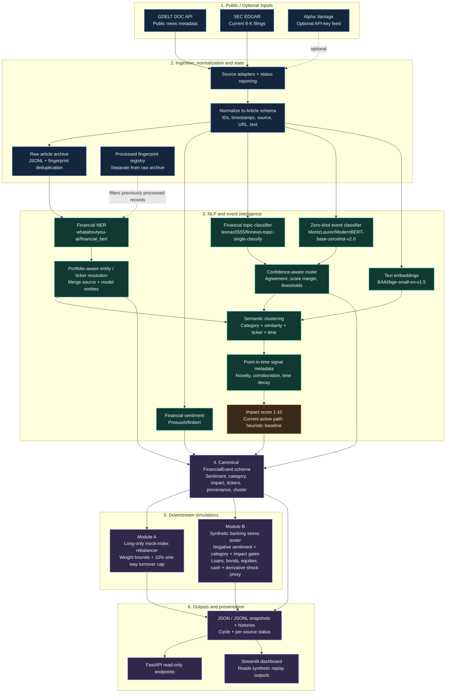

# EventPulse Architecture

EventPulse converts public financial headlines and corporate filings into structured event signals, then demonstrates two downstream risk workflows. The Mermaid diagram below is the source-of-truth architecture view; `docs/architecture.png` is its presentation-ready companion image.

## Core design choices

- **One canonical event contract:** downstream modules consume `FinancialEvent` objects rather than parsing raw headlines independently.
- **Distinct source and processed state:** archiving a record does not imply that the NLP and downstream cycle completed.
- **Explicit source provenance:** timestamps, source names, URLs and ticker metadata remain attached where supplied.
- **Point-in-time clustering signals:** the engine considers only articles available as of an article's publication time when calculating novelty and corroboration, reducing future-report leakage.
- **Constrained simulations:** Module A enforces long-only weight bounds and a one-way turnover cap, applies the event-specific decay once, and emits progressive replay snapshots; Module B requires negative sentiment for downside scenario triggers and uses declared synthetic scenario assumptions including a simplified derivative shock proxy.
- **Honest model status:** the currently active impact score is an interpretable heuristic. The historical training workflow exists, but a trained/accepted impact-model artifact is not included in the repository version reviewed.

## Model inventory

| Model / component | Role | Status in this repository |
|---|---|---|
| `ProsusAI/finbert` | Financial sentiment | Pretrained inference |
| `whataboutyou-ai/financial_bert` | Financial named-entity extraction | Pretrained inference |
| `leonas5555/finnews-topic-single-classify` | Financial-news topic classification | Pretrained inference |
| `MoritzLaurer/ModernBERT-base-zeroshot-v2.0` | Event labels from candidate descriptions | Pretrained inference, routed with topic model |
| `BAAI/bge-small-en-v1.5` | Text embeddings for semantic similarity | Pretrained inference; general-purpose English embedding model, not a custom finance-fine-tuned model |
| `src/engine/impact.py` | Explainable 1-10 impact score | Heuristic baseline currently active |

## Execution paths

- **Live:** `python -m src.engine.run_live_pipeline --limit 10 --timespan 1day`. Uses public feeds and the live 12-stock mock-index universe. It does not silently substitute synthetic data when a live source fails.
- **Synthetic replay:** `python -m src.engine.run_demo_pipeline`. Uses `data/demo/index_articles.json` (synthetic headlines assigned to the configured 12-stock ticker universe), `data/demo/index_portfolio.json`, and the USD-denominated synthetic banking portfolio and scenarios. Outputs are written under `data/processed/demo_replay/` (ignored by Git) and read by `src/dashboard/app.py`.
- **Dashboard:** `python -m streamlit run src/dashboard/app.py`. The Streamlit page displays the saved synthetic replay; it does not run transformer inference on each refresh.
- **API:** `uvicorn src.api.main:app --reload`. A read-only API over the persisted outputs.
